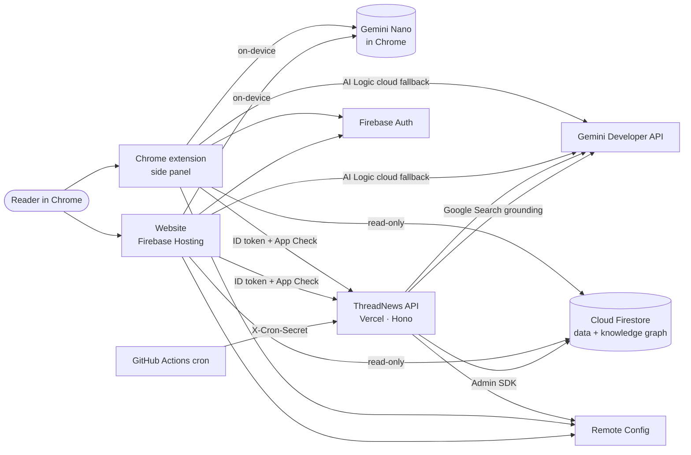

# ARCHITECTURE.md — overview

This is the entry point to the architecture series. Each section links to a deeper doc in `docs/architecture/`.

| # | Doc | Covers |
|---|---|---|
| 01 | [Deployment & free tier](docs/architecture/01-deployment-free-tier.md) | Where everything runs, $0 budget, limits, upgrade path |
| 02 | [Hybrid AI](docs/architecture/02-hybrid-ai.md) | On-device vs cloud, models, AI Logic usage |
| 03 | [Data model](docs/architecture/03-data-model.md) | Firestore collections, graph schema, indexes |
| 04 | [Auth & quotas](docs/architecture/04-auth-and-quotas.md) | Guest vs member, JWT, limits, enforcement |
| 05 | [Request flows](docs/architecture/05-request-flows.md) | Sequence diagrams for every main flow |
| 06 | [Security & privacy](docs/architecture/06-security-privacy.md) | Threats, rules, what data goes where |
| 07 | [Decisions (ADRs)](docs/architecture/07-decisions.md) | Why we chose what we chose |

Component docs: [API](docs/API.md) · [GraphRAG](docs/GRAPHRAG.md) · [Website](docs/WEBSITE.md) · [Extension](docs/EXTENSION.md) · [Prompts](docs/PROMPTS.md).

## 1. System context



## 2. Containers

| Container | Tech | Hosted on (free) | Responsibility |
|---|---|---|---|
| **Extension** | WXT, React, TS, MV3 | GitHub Releases zip (+ optional Web Store) | Read the article, run on-device AI, show status, follow |
| **Website** | Vite, React, TS | Firebase Hosting (Spark) | Paste-a-link checks, explainer, Q&A, graph view, followed stories |
| **API** | Hono, TS, Node 22, firebase-admin, @google/genai | Vercel Hobby | Auth + App Check verification, quotas, GraphRAG retrieval, cloud check, explainer, Q&A, ingest, cron jobs |
| **Firestore** | Native mode | Firebase Spark | Users, usage, checks, knowledge graph, cached explainers |
| **Firebase Auth** | Anonymous + Google | Spark | Identity, JWT (ID tokens) |
| **App Check** | reCAPTCHA v3 (web), debug provider (extension) | Spark | Only our apps may call AI Logic, Firestore and the API |
| **Remote Config** | client + server templates | Spark | Models, limits, thresholds, feature flags |
| **Firebase AI Logic** | `firebase/ai`, Gemini Developer API backend | Spark (Gemini free tier) | Hybrid on-device-first inference in the clients |
| **Scheduler** | GitHub Actions `schedule:` | Free for public repos | Hourly community build, 6-hourly re-check of followed stories |

## 3. The core loop

```
read article → gatekeeper (on-device) → worth checking?
   no  → summary only
   yes → API /v1/graph/retrieve → known & fresh?
           yes → on-device graph check (no cloud)
           no  → API check (quota) → Gemini + Google Search → ingest into graph
        → status: still current (Case A) | moved on (Case B) → explainer / follow
```

## 4. Key properties

- **Hybrid by design:** Nano reads the page; the cloud knows the world. Grounding is cloud-only in hybrid mode, so the split follows the SDK's real boundary.
- **Graph memory:** every cloud check enriches the graph; later checks of the same story are cheaper, faster and often fully on-device.
- **Privacy:** article text never leaves the device or gets stored.
- **Cost:** $0 — Spark + Gemini free tier + Vercel Hobby + GitHub Actions. Quotas and caching keep us inside free limits.
- **Portable backend:** the Hono app runs on Vercel today and can be wrapped as a Cloud Function (`onRequest`) on Blaze without code changes.

## 5. Repo layout

```
apps/
  web/          src/{routes,features,components,lib}  firebase.json (hosting)
  extension/    entrypoints/{background.ts,sidepanel/,content.ts?}  wxt.config.ts
  api/          src/{app.ts,routes/,middleware/,services/,cron/}  api/[[...route]].ts (Vercel entry)
packages/
  shared/       schemas/ prompts/ ai/ api-client/ config/
  ui/           components/ styles/tokens.css
  graph/        ingest/ resolve/ search/ communities/ pack/
scripts/        seed-graph.ts  stories.seed.json
.github/workflows/  ci.yml  cron.yml  release-extension.yml
firestore.rules  firestore.indexes.json  remoteconfig.template.json
docs/
```
