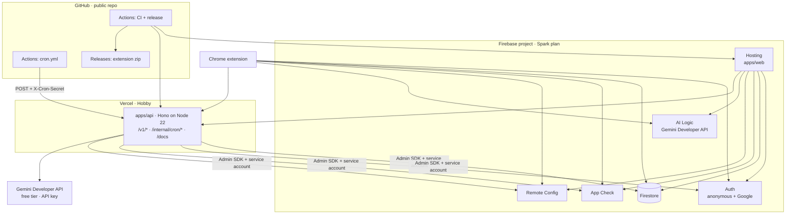

# 01 · Deployment & free tier

Goal: **everything public, everything $0**, and still running for judges until **Dec 16, 2026**.

## Why not Cloud Functions?

Firebase's free **Spark** plan does not include Cloud Functions, Firestore triggers or Cloud Run — those need the **Blaze** plan with a linked billing account. The hackathon "quota account" is valid for only 4 days (≈ Nov 27 – Dec 1), but judging runs Dec 10–16, so production must not depend on it.

So: Firebase Spark for everything Firebase offers for free, plus a small **API on Vercel Hobby** for server logic, plus **GitHub Actions** for schedules.

## Topology

## Where each piece runs

| Piece | Service | Free-tier notes |
|---|---|---|
| Website | Firebase Hosting | 10 GB storage, ~360 MB/day transfer. SPA build is ~1 MB. |
| Auth | Firebase Auth | Anonymous + Google sign-in are no-cost. |
| Database + graph | Cloud Firestore | **50k reads, 20k writes, 20k deletes per day, 1 GiB stored.** Our main constraint — see budget below. |
| App Check | reCAPTCHA **v3** provider (web) | v3 is free; avoid reCAPTCHA Enterprise (may need billing). Extension uses the debug provider for the judge build. |
| Remote Config | Firebase | Generous daily fetch limit; cache 1 h on clients. |
| On-device + fallback AI | Firebase AI Logic → Gemini Developer API | Uses the project's Gemini free-tier quota. Check active limits in AI Studio. |
| API | Vercel Hobby (Node runtime) | Free, ~1M invocations/month, **non-commercial use only** (fine for a free hackathon project). Use `waitUntil` for post-response work. |
| Server AI | Gemini Developer API with an AI Studio key | Free tier rate limits per model (see AI Studio). Google Search grounding has its own daily cap. |
| Schedules | GitHub Actions `schedule:` | Free unlimited minutes on public repos. Cron precision ±15 min. |
| Extension distribution | GitHub Releases | Free. Chrome Web Store listing needs a one-time $5 developer fee (optional, nicer for judges). |
| API docs | `/docs` (Scalar UI) + `/v1/openapi.json` on Vercel | Public. |

## Daily budget (keep inside free limits)

| Resource | Free/day | Our budget | How |
|---|---|---|---|
| Firestore reads | 50,000 | ≤ 35,000 | Local search ≤ 60 reads; cache retrieve results 10 min in API memory; community job reads 1 snapshot doc, not the graph |
| Firestore writes | 20,000 | ≤ 12,000 | Ingest ≈ 30–60 writes per new story; usage counters 1 write per call |
| Gemini cloud calls (API) | per AI Studio | global cap in Remote Config `global_daily_ai_budget` | Every API AI call increments `usage/_global/days/{date}`; at cap → `503 budget_exhausted`, UI falls back to on-device |
| Grounded requests | per AI Studio | ≤ cap above | Cache-first: fresh graph result = no search |
| Vercel invocations | ~33k | ≪ | |

If a free limit is hit, the app **degrades, not dies**: on-device summary, gatekeeper and graph checks keep working; cloud features show "High demand — try again later".

## Environments

| Env | Firebase | API | Notes |
|---|---|---|---|
| `local` | Emulators (Auth, Firestore) | `pnpm dev` on :8787 | App Check debug tokens; Gemini key from `.env.local` |
| `prod` | `threadnews-prod` (Spark) | `threadnews-api.vercel.app` | The only deployed env (no staging — time) |

## Upgrade path (if we get Blaze later)

1. `apps/api/src/adapters/firebase-functions.ts` wraps the same Hono app with `onRequest` from `firebase-functions/v2/https`.
2. Add Hosting rewrite `/api/** → function` (same-origin, no CORS).
3. Optionally move ingest to a Firestore trigger and cron to `onSchedule`.
4. Nothing in clients changes except `API_BASE_URL`.

## Deploy pipeline (summary — details in `docs/DEPLOYMENT.md`)

- Push to `main` → CI: lint, typecheck, test, build.
- `apps/web` → `firebase deploy --only hosting,firestore:rules,firestore:indexes` (GitHub Action with `FIREBASE_TOKEN` / service account).
- `apps/api` → Vercel Git integration (auto-deploy on `main`).
- Tag `ext-v*` → build extension zip → GitHub Release.
