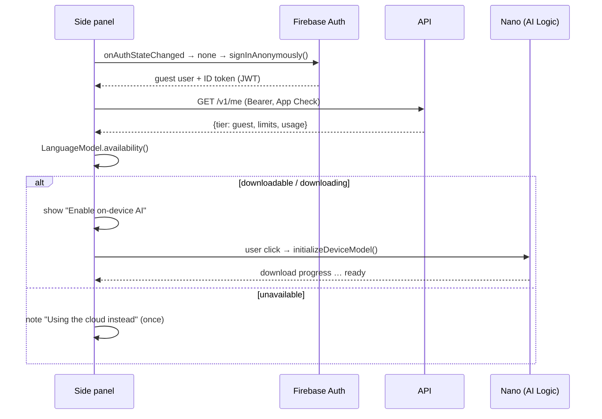
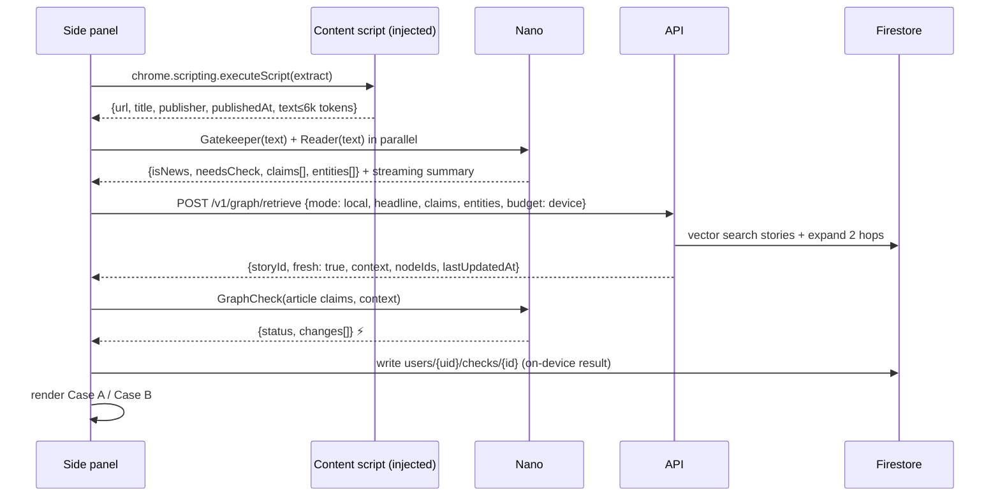
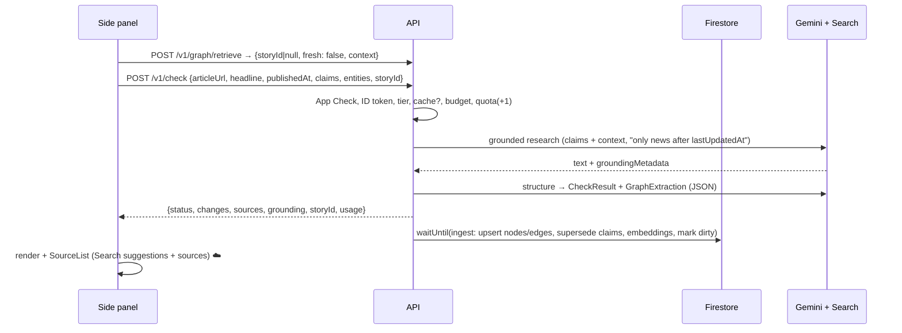
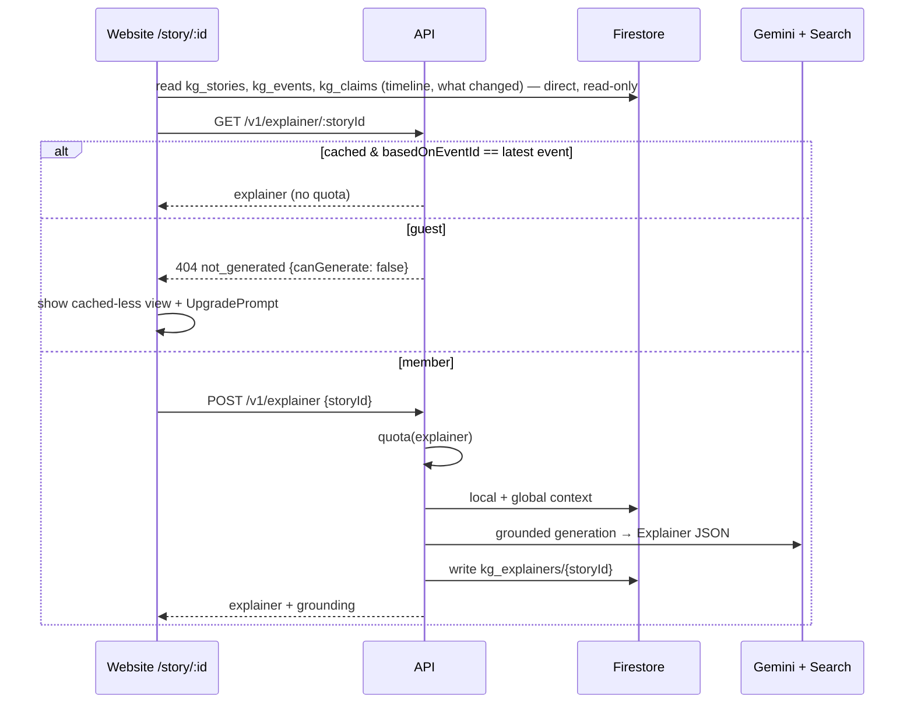
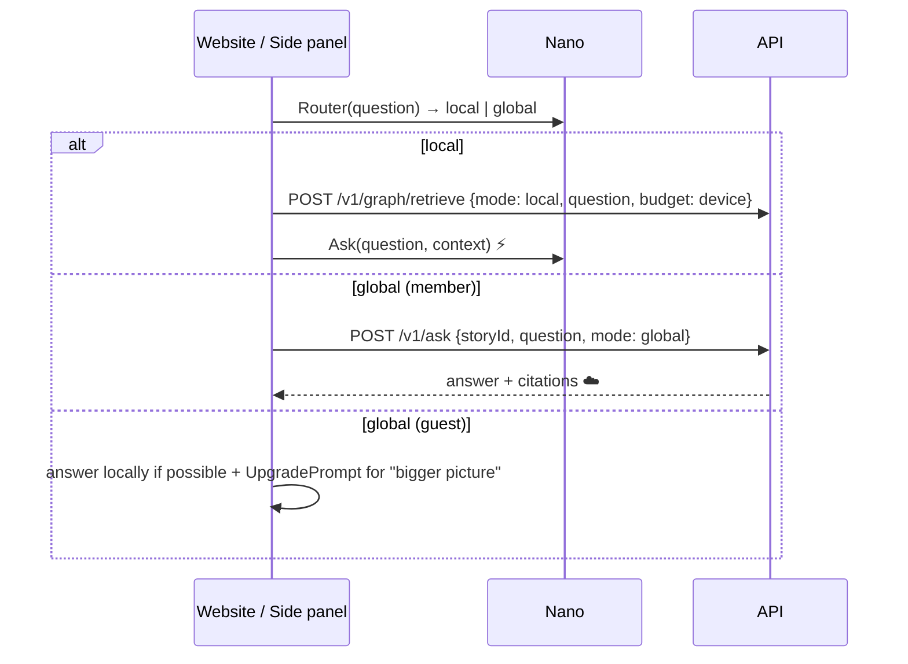
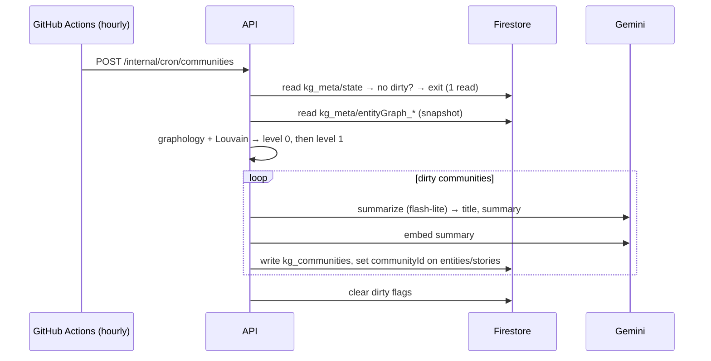
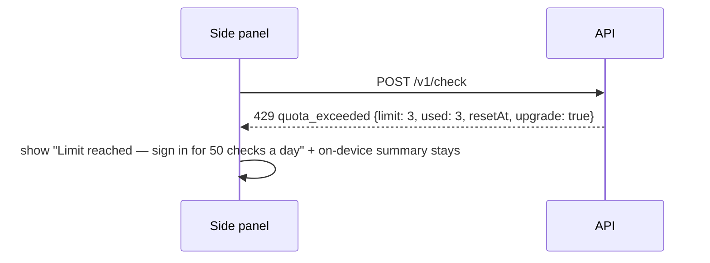

# 05 · Request flows

Mermaid sequence diagrams for the main flows. Participants: **SP** = extension side panel (or website page), **N** = Gemini Nano via AI Logic, **API** = apps/api, **FS** = Firestore, **G** = Gemini Developer API.

## 1. First open



## 2. Check an article — story known & fresh (no cloud)



## 3. Check an article — new or stale story (cloud)



## 4. Explainer (website)



## 5. Ask about this story



## 6. Follow + scheduled re-check

```mermaid
sequenceDiagram
  participant SP as Side panel
  participant API
  participant FS as Firestore
  participant GH as GitHub Actions (every 6 h)
  participant G as Gemini + Search
  SP->>API: POST /v1/follows {storyId, articleUrl} (member)
  API->>FS: users/{uid}/follows/{storyId}; kg_stories.followerCount +1
  GH->>API: POST /internal/cron/recheck (X-Cron-Secret)
  API->>FS: stories where followerCount > 0, oldest lastCheckedAt first (≤ 25 per run)
  loop each story
    API->>G: grounded check with local context
    API->>FS: ingest new events/claims, update status
  end
  SP->>FS: onSnapshot(followed story) → new event → "Update available"
  Note over SP: chrome.alarms (30 min) also polls and sets the toolbar badge
```

## 7. Community build (GraphRAG global index)



## 8. Limit reached


